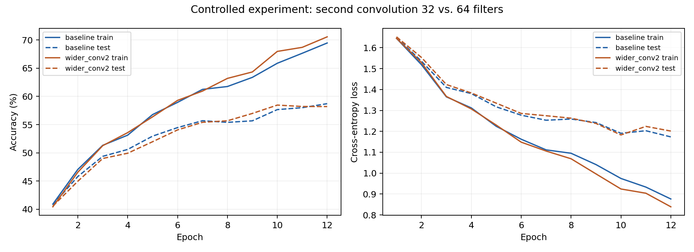
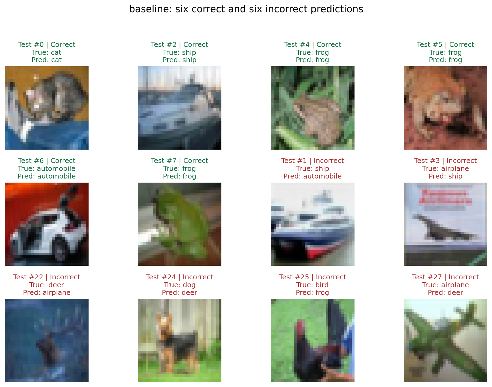
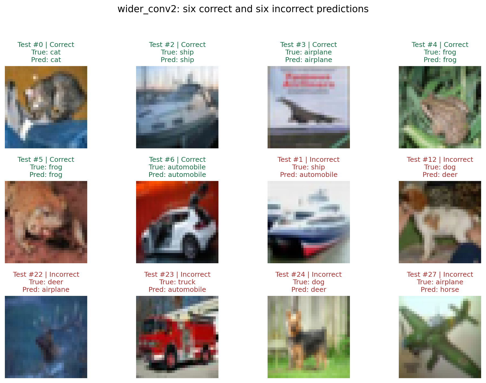

# Homework 4: CIFAR-10 Image Classification with PyTorch

This repository contains the code and recorded results for Question 4 of an introductory artificial intelligence assignment. It compares a small convolutional neural network (CNN) with a variant that doubles the number of filters in its second convolutional layer.

Both models are trained on the same random subset of **10,000 CIFAR-10 training images** and evaluated on the **standard 10,000-image test set**. The repository includes trained checkpoints, parameter calculations, training curves, and every test prediction, so the recorded experiment can be inspected without retraining.

Questions 1 and 2 are analytical exercises, and Question 3 uses Transformer Explainer. Their answers and screenshots are in the separately submitted PDF; this repository focuses on the CNN experiment.

## Repository contents

```text
.
├── README.md
├── .gitignore
├── q4_cnn.py                       # Data loading, models, training, evaluation, plots
├── q4_analyze.py                   # Verify checkpoints and saved predictions
├── q4_requirements.txt             # Python dependencies
├── data/
│   └── download_provenance.json    # Dataset source and checksum
└── output/
    └── q4/
        ├── experiment_config.json
        ├── training_indices.npy
        ├── training_history.csv
        ├── results.json
        ├── verification.json
        ├── q4_results_and_analysis.txt
        ├── training_curves.png
        ├── baseline.pt
        ├── wider_conv2.pt
        └── ...                    # Architecture records, predictions, and figures
```

The CIFAR-10 archive, extracted dataset, local Python environment, and temporary files are excluded from version control. The two small `.pt` checkpoints are included intentionally.

## Setup

The recorded experiment ran on Windows with Python **3.13.5**, PyTorch **2.10.0+cpu**, torchvision **0.25.0+cpu**, NumPy **2.3.5**, and Matplotlib **3.10.0**. A GPU is not required.

Create and activate a virtual environment from the repository root:

```bash
python -m venv .venv
```

On Windows PowerShell:

```powershell
.\.venv\Scripts\Activate.ps1
```

On macOS or Linux:

```bash
source .venv/bin/activate
```

Install the dependencies:

```bash
python -m pip install -r q4_requirements.txt
```

The requirements pin the core package versions. For the CPU-only PyTorch builds used in the recorded experiment, install these builds first, then run the requirements command above:

```bash
python -m pip install torch==2.10.0 torchvision==0.25.0 --index-url https://download.pytorch.org/whl/cpu
```

Exact numerical reproducibility may depend on the operating system, hardware, and library builds. The original environment and subset hash are recorded in [`experiment_config.json`](output/q4/experiment_config.json).

## Run the experiment

Run commands from the repository root.

### Verify the included results without retraining

First download and check the dataset, then reload the included model checkpoints and compare their test predictions with the saved CSV files:

```bash
python q4_cnn.py --download-only --threads 4
python q4_analyze.py
```

The verification script checks both checkpoints against all 10,000 saved test predictions, verifies the training subset and epoch history, and writes `output/q4/verification.json`. It also refreshes the English results record and creates `output/Q4_code_and_results.zip`, an experiment archive. That generated ZIP is ignored by Git; the repository itself includes this README and `.gitignore` in addition to the archived experiment files.

### Retrain both models

```bash
python q4_cnn.py --epochs 12 --threads 4 --device cpu
python q4_analyze.py
```

The training command runs the baseline followed by the wider model and overwrites the experiment outputs under `output/q4/`. Save a separate copy of the recorded outputs if you want to preserve them while experimenting with different settings. CPU is the default device and was used for all reported results.

### Dataset download

The script uses `torchvision.datasets.CIFAR10(..., download=True)` and stores data in `data/`. A complete download is approximately 170 MB, before extraction.

For the recorded run, the unchanged archive was obtained from the mirror listed in [`data/download_provenance.json`](data/download_provenance.json) and verified against torchvision's official checksum:

```text
Filename: cifar-10-python.tar.gz
MD5:      c58f30108f718f92721af3b95e74349a
```

If the original server is unavailable, place the archive from that recorded mirror at `data/cifar-10-python.tar.gz` and rerun the download-only command. Torchvision checks its integrity and extracts it. Do not commit the dataset to this repository.

## Experimental design

| Setting | Value |
| --- | --- |
| Dataset loader | `torchvision.datasets.CIFAR10` |
| Training subset | 10,000 of the standard 50,000 training images, without replacement |
| Test set | All 10,000 standard test images |
| Sampling | `numpy.random.default_rng(42)` |
| Model initialization seed | 42, reset before each model |
| Training shuffle seed | 2026, using a separate generator for each model |
| Input | RGB, `3 × 32 × 32` |
| Preprocessing | Divide by 255; normalize each channel with mean 0.5 and standard deviation 0.5 |
| Data augmentation | None |
| Loss | Cross-entropy on raw logits |
| Optimizer | Adam, learning rate 0.001, weight decay 0.0001 |
| Batch size | 128 |
| Epochs | 12 |
| Device / CPU threads | CPU / 4 |
| Reported checkpoint | Fixed final epoch |

Both models use the same sampled images and training-batch order. Training and test metrics are evaluated after each epoch in evaluation mode. The test set is not used for gradient updates, hyperparameter selection, or checkpoint selection. Deterministic PyTorch algorithms are enabled for the training run.

The controlled change is **32 → 64 output channels in the second convolution**. The input dimension of the first fully connected layer necessarily increases from 2,048 to 4,096. All other architecture choices and training settings remain fixed. Using the same seed does not imply that every corresponding weight is identical across differently shaped networks.

## Baseline architecture

Shapes below omit the batch dimension. Both convolutions use bias, stride 1, padding 1, and dilation 1.

| Layer | Output shape | Trainable parameters |
| --- | --- | ---: |
| Input | `3 × 32 × 32` | 0 |
| `Conv2d(3, 16, kernel_size=3)` | `16 × 32 × 32` | 448 |
| ReLU, `MaxPool2d(2, 2)` | `16 × 16 × 16` | 0 |
| `Conv2d(16, 32, kernel_size=3)` | `32 × 16 × 16` | 4,640 |
| ReLU, `MaxPool2d(2, 2)` | `32 × 8 × 8` | 0 |
| Flatten | `2,048` | 0 |
| `Linear(2048, 64)`, ReLU | `64` | 131,136 |
| `Linear(64, 10)` | `10` logits | 650 |
| **Total** | | **136,874** |

### First-convolution calculation

For an input of shape `(N, 3, 32, 32)`, with kernel size `k = 3`, stride `s = 1`, padding `p = 1`, and dilation `d = 1`:

```text
H_out = floor((H + 2p - d(k - 1) - 1) / s + 1)
      = floor((32 + 2 - 2 - 1) / 1 + 1)
      = 32

W_out = 32
Output shape before pooling = (N, 16, 32, 32)

Parameters = C_out × (C_in × k_h × k_w + 1)
           = 16 × (3 × 3 × 3 + 1)
           = 448
           = 432 kernel weights + 16 biases
```

The `layer_details` function in [`q4_cnn.py`](q4_cnn.py) verifies the output shape using a dummy tensor and counts parameters with `numel()`. The observed shape is `(1, 16, 32, 32)` and the observed parameter count is 448.

Convolutional filters share their weights across image positions. Increasing image height or width changes the number of filter applications and output activations, but does not create additional convolution parameters. A fully connected layer after flattening can depend on spatial dimensions.

### Wider model calculation

```text
conv1:  448
conv2:  64 × (16 × 3 × 3 + 1) = 9,280
fc1:    4,096 × 64 + 64       = 262,208
fc2:    64 × 10 + 10          = 650
Total:  272,586
```

## Recorded results

All results below are from epoch 12. Accuracy is the percentage of correctly classified images.

| Model | Parameters | Training accuracy | Test accuracy | Test correct | Test loss |
| --- | ---: | ---: | ---: | ---: | ---: |
| Baseline | 136,874 | 69.46% | 58.71% | 5,871 / 10,000 | 1.1734 |
| Wider second convolution | 272,586 | 70.55% | 58.20% | 5,820 / 10,000 | 1.2013 |

The wider network has **135,712 additional parameters (+99.15%)**. Training accuracy improves by **1.09 percentage points**, while test accuracy decreases by **0.51 percentage points**. The train–test accuracy gap grows from 10.75 to 12.35 percentage points.

The expectation was that additional filters would increase feature capacity and could improve fitting, while a test-accuracy improvement was uncertain with only 10,000 training examples. The observed result is consistent with improved training fit without a generalization benefit under these settings. This single-seed comparison does not establish statistical significance or imply that wider CNNs always perform worse.

### Training curves



Solid lines show training metrics; dashed lines show test metrics. Final metrics are also available in [`results.json`](output/q4/results.json), and the complete history is in [`training_history.csv`](output/q4/training_history.csv).

### Prediction examples

Each figure shows the first six correctly classified test images followed by the first six incorrectly classified test images, in row-major order. Labels include the test index, true class, and predicted class. This selection rule is deterministic.





For example, the baseline recognizes the cat in test image #0, but predicts deer for the dog in #24 and frog for the bird in #25. CNNs suit images because local filters detect spatial patterns and shared weights reuse those detectors across positions. Later layers combine local features, while pooling reduces spatial dimensions and provides some tolerance to small shifts. Low resolution, similar shapes and textures, backgrounds, and limited training data may contribute to errors; these examples do not identify a unique cause for each mistake.

## Saved evidence

All paths below are relative to `output/q4/`.

| Files | Purpose |
| --- | --- |
| `experiment_config.json` | Hyperparameters, environment, class counts, and subset hash |
| `training_indices.npy` | Exact 10,000 training indices |
| `results.json` | Final model metrics and parameter counts |
| `training_history.csv` | Per-epoch training/test accuracy, loss, and duration |
| `*_architecture.json` | Per-layer output shapes and parameter counts |
| `baseline.pt`, `wider_conv2.pt` | Final model state dictionaries, configuration, and metrics |
| `*_test_predictions.csv` | All 10,000 test predictions for each model |
| `*_confusion_matrix.csv` | Counts with true classes in rows and predicted classes in columns |
| `*_examples.json` | Test indices and labels used in the example figures |
| `*.png` | Learning curves and prediction examples |
| `verification.json` | Checkpoint/prediction consistency checks and training-code hash |
| `q4_results_and_analysis.txt` | Detailed English parameter calculations and discussion |

Confusion-matrix rows use the same class order as their column headers and `experiment_config.json`: airplane, automobile, bird, cat, deer, dog, frog, horse, ship, truck.

## References

- [CIFAR-10 dataset description](https://www.cs.toronto.edu/~kriz/cifar.html)
- [Torchvision CIFAR10 dataset](https://docs.pytorch.org/vision/stable/generated/torchvision.datasets.CIFAR10.html)
- [PyTorch: Training a Classifier](https://docs.pytorch.org/tutorials/beginner/blitz/cifar10_tutorial.html)
